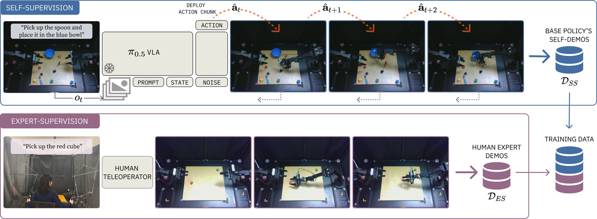

<h1 align="center">Fine-Tuning VLAs with Self-Demonstrated Generative Control for Multi-Task Manipulation</h1>

<p align="center">
  <a href="https://prachigarg23.github.io/">Prachi Garg</a>,
  Steve Xing<sup>*</sup>,
  Prahit Yaugand<sup>*</sup>,
  <a href="https://saurabhg.web.illinois.edu/">Saurabh Gupta</a>,
  <a href="https://dhoiem.cs.illinois.edu/">Derek Hoiem</a>
  <br>
  University of Illinois Urbana-Champaign
  <br>
  <sub><sup>*</sup>Equal contribution</sub>
</p>

<p align="center">
  <a href="https://arxiv.org/abs/2608.19490"></a>
  <a href="https://self-supervised-control.pages.dev/"></a>
  <a href="https://github.com/prachigarg23/self-supervised-control-robotwin"></a>
  <a href="#datasets"></a>
  <a href="#checkpoints"></a>
</p>

<p align="center">
  
</p>

## :rocket: Release Overview

> [!IMPORTANT]
> **RoboTwin simulation and evaluation code lives in a separate repo: [self-supervised-control-robotwin](https://github.com/prachigarg23/self-supervised-control-robotwin)** (included here as the `third_party/robotwin` submodule).

:white_check_mark: Training code and paper configs, [RoboTwin sim/eval code](https://github.com/prachigarg23/self-supervised-control-robotwin), [ALOHA real-robot code](third_party/aloha/README.md), [datasets](#datasets) and [checkpoints](#checkpoints).

## Installation

Requirements: Linux, an NVIDIA GPU, and a CUDA 12.x toolkit (`nvcc`) to build pytorch3d and cuRobo. Training needs about 50 GB of GPU memory (we used H200s); on smaller GPUs, shard with `--fsdp-devices`.

```bash
git clone https://github.com/prachigarg23/self-supervised-continual-control.git
cd self-supervised-continual-control
git submodule update --init --recursive
```

### Install openpi

```bash
conda create -n openpi python=3.11 -y
conda activate openpi
pip install torch==2.7.1 torchvision==0.22.1 torchaudio==2.7.1 --index-url https://download.pytorch.org/whl/cu128
pip install -U "jax[cuda12]==0.5.3"
conda install -y git-lfs ffmpeg -c conda-forge
git lfs install

# install lerobot manually, from source, outside the self-supervised-continual-control directory
cd ..
GIT_LFS_SKIP_SMUDGE=1 git clone https://github.com/huggingface/lerobot.git
cd lerobot
git checkout 0cf864870cf29f4738d3ade893e6fd13fbd7cdb5
pip install -e . --no-deps

cd ../self-supervised-continual-control
pip install -e packages/openpi-client
pip install -e .
pip install datasets==3.6.0 transformers==4.53.2 tokenizers==0.21.4 huggingface-hub==0.36.0 sentencepiece==0.2.1 safetensors==0.7.0 chex==0.1.90 pyarrow==22.0.0 pytest
```


### Install RoboTwin Sim

```bash
cd third_party/robotwin
pip install -r <(grep -v -i -E '^(torch|huggingface_hub|scipy|imageio)==' script/requirements.txt)
pip install "git+https://github.com/facebookresearch/pytorch3d.git@stable" --no-build-isolation

# patch sapien (read URDFs as utf-8) and mplib (don't abort screw motion plans on collision)
SAPIEN_LOCATION=$(pip show sapien | grep 'Location' | awk '{print $2}')/sapien
sed -i -E 's/("r")(\))( as)/\1, encoding="utf-8") as/g' $SAPIEN_LOCATION/wrapper/urdf_loader.py
MPLIB_LOCATION=$(pip show mplib | grep 'Location' | awk '{print $2}')/mplib
sed -i -E 's/(if np.linalg.norm\(delta_twist\) < 1e-4 )(or collide )(or not within_joint_limit:)/\1\3/g' $MPLIB_LOCATION/planner.py

# installing curobo
cd envs
git clone https://github.com/NVlabs/curobo.git
cd curobo
git checkout d64c4b005459db10c5dd867d8b30a87d5bda9bdb
pip install -e . --no-build-isolation
cd ../..
pip install "setuptools<81" wheel ninja warp-lang==1.12.0
pip check

bash script/_download_assets.sh
echo 'export CUROBO_USE_LRU_CACHE=1' >> ~/.bashrc
```


## Datasets


| Dataset                                                                                                                                              | Contents                           |
| ---------------------------------------------------------------------------------------------------------------------------------------------------- | ---------------------------------- |
| [`prachigarg23/aloha_pick_up_red_green_cubes_expert`](https://huggingface.co/datasets/prachigarg23/aloha_pick_up_red_green_cubes_expert)             | ALOHA pick-up, expert              |
| [`prachigarg23/aloha_pick_place_self_demos`](https://huggingface.co/datasets/prachigarg23/aloha_pick_place_self_demos)                               | ALOHA pick-place, self-demos         |
| [`prachigarg23/aloha_bimanual_gear_insertion_expert`](https://huggingface.co/datasets/prachigarg23/aloha_bimanual_gear_insertion_expert)             | ALOHA gear insertion, expert       |
| [`prachigarg23/robotwin_mid_training_expert`](https://huggingface.co/datasets/prachigarg23/robotwin_mid_training_expert)                             | RoboTwin mid-training, expert      |
| [`prachigarg23/robotwin_post_training_stack_blocks_expert`](https://huggingface.co/datasets/prachigarg23/robotwin_post_training_stack_blocks_expert) | RoboTwin post-training, expert     |
| [`prachigarg23/robotwin_self_demos`](https://huggingface.co/datasets/prachigarg23/robotwin_self_demos)                                               | RoboTwin post-training, self-demos |


## Checkpoints

```bash
hf download prachigarg23/<config> --local-dir checkpoints/<config>
```

| Model                                                                                                                                                                 | Config                                   |
| --------------------------------------------------------------------------------------------------------------------------------------------------------------------- | ---------------------------------------- |
| [ALOHA pick-up, ES+SS](https://huggingface.co/prachigarg23/pi05_FAST_aloha_pick_up_ES_SS)                   | `pi05_FAST_aloha_pick_up_ES_SS`          |
| [ALOHA pick-up, ES](https://huggingface.co/prachigarg23/pi05_FAST_aloha_pick_up_ES)                         | `pi05_FAST_aloha_pick_up_ES`             |
| [ALOHA gear insertion, ES+SS](https://huggingface.co/prachigarg23/pi05_FAST_aloha_gear_insertion_ES_SS)     | `pi05_FAST_aloha_gear_insertion_ES_SS`   |
| [ALOHA gear insertion, ES](https://huggingface.co/prachigarg23/pi05_FAST_aloha_gear_insertion_ES)           | `pi05_FAST_aloha_gear_insertion_ES`      |
| [RoboTwin mid-training](https://huggingface.co/prachigarg23/pi05_FAST_robotwin_mid_training)                | `pi05_FAST_robotwin_mid_training`        |
| [RoboTwin post-training, ES+SS](https://huggingface.co/prachigarg23/pi05_FAST_robotwin_post_training_ES_SS) | `pi05_FAST_robotwin_post_training_ES_SS` |
| [RoboTwin post-training, ES](https://huggingface.co/prachigarg23/pi05_FAST_robotwin_post_training_ES)       | `pi05_FAST_robotwin_post_training_ES`    |

## Training

```bash
python scripts/train.py pi05_FAST_robotwin_post_training_ES_SS --exp-name=paper
```

RoboTwin post-training starts from the mid-training checkpoint. Run `mid_training` first, or download it:

```bash
hf download prachigarg23/pi05_FAST_robotwin_mid_training --local-dir checkpoints/pi05_FAST_robotwin_mid_training/paper/10000
```

The gear-insertion self-demo dataset is not released yet, so `gear_insertion_ES_SS` can only be evaluated from its checkpoint.


## Evaluation

- RoboTwin: [third_party/robotwin/README.md](https://github.com/prachigarg23/self-supervised-control-robotwin/blob/main/README.md)
- ALOHA (real robot): [third_party/aloha/README.md](third_party/aloha/README.md)

## Acknowledgements

This code builds on [openpi](https://github.com/Physical-Intelligence/openpi) and [RoboTwin](https://github.com/RoboTwin-Platform/RoboTwin).

## Citation

```bibtex
@misc{garg2026finetuningvlasselfdemonstratedgenerative,
      title={Fine-Tuning VLAs with Self-Demonstrated Generative Control for Multi-Task Manipulation},
      author={Prachi Garg and Steve Xing and Prahit Yaugand and Saurabh Gupta and Derek Hoiem},
      year={2026},
      eprint={2608.19490},
      archivePrefix={arXiv},
      primaryClass={cs.RO},
      url={https://arxiv.org/abs/2608.19490},
}
```

